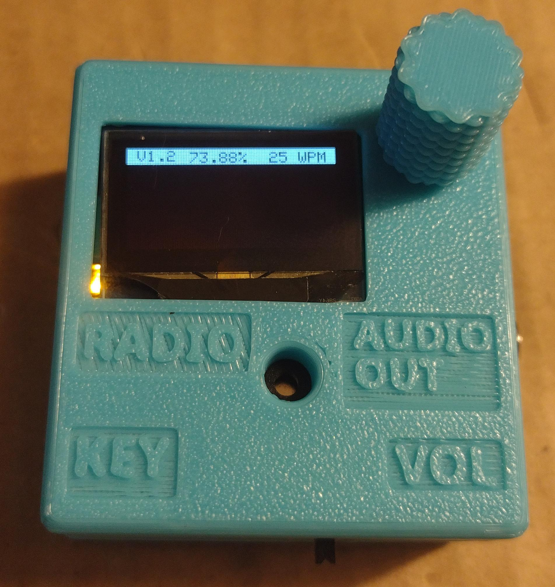

<h1><u><b>Micro Keyer</b></u></h1>

  
  

  
  
  
  
  

 
 
The <b>Micro Keyer</b> is a small morse code keyer that can be used as a practice oscillator. It supports Iambic A, Iambic B, bug emulation, and straight key keying modes.
 
 
<h1><u><b><a href="https://grilled-cheese-engineering.github.io/micro-keyer/" target="_blank">View bill of materials</a></b></u></h1>
 
 
 

<h2><u><b>Version Notes</b></u></h2>
<ul>
  <li><h4><u><b>V1.0 Board:</b></u></h4> There is a problem with the power switch in the V1.0 board where the display does not turn off when the device is turned off. <h4><u><b>Fix:</b></u></h4>
      <ol type="1">
        <li>Do not solder the jumper pad that connects the display to power.</li> 
        <li>Connect a jumper wire between top leg of Q1 (3V) to the left side of the power switch.</li>  
        <li>Solder a wire from the center pin of the switch to the power pin on the display.</li> 
      </ol>
      <h5>(Note: the two side pins on the switch are not connected to anything so it is okay if the jumper wire is making contact with them.)</h5>
       
      
  </li>
</ul>
